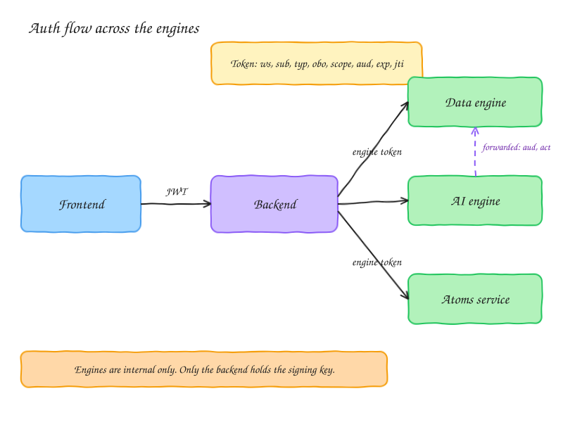

# Auth design: tokens across the engines

Status: design, not yet built. Current code: [app/api/auth.py](../app/api/auth.py), [app/api/tokens.py](../app/api/tokens.py). Agent tokens are off (`AGENT_TOKENS_ENABLED=false`).

Written for: engineers working on the backend, the data engine, and the AI engine.

## Goal

One identity model for every caller: a human in the app, a personal assistant acting for a human, an automated agent, a scheduled run, and an engine calling another engine. Every service reads the same claims and enforces the same rules.

## Who calls what



Text form:

```
Frontend  --JWT-->  Backend  --engine token-->  Data engine
                       |                        AI engine
                       +--engine token-->       Atoms service
                                                  ^
AI engine ----------- token (forwarded or minted by backend) ---+
```

- The **backend is the only front door**. The frontend never calls an engine directly.
- Engines are **not reachable from the internet**. Ingress must be internal only. Check per app (`az containerapp show`, `ingress.external`).
- The **backend verifies** the end-user JWT, checks the member is active and scopes are granted, then calls the engine with an engine token.

## Token claims

| Claim | Meaning | Required |
|---|---|---|
| `iss` | issuer, always the backend | yes |
| `aud` | services allowed to accept the token, for example `["data-engine"]` | yes |
| `sub` | acting principal: a human member id, an agent member id, or a service name | yes |
| `ws` | workspace id. The only workspace the token is valid for | yes |
| `typ` | `human`, `agent`, `run`, or `service` | yes |
| `mem` | member the writes are attributed to (existing claim) | when a member acts |
| `obo` | human member id when an agent acts for a human | when delegated |
| `act` | service that made the call, for engine-to-engine hops | when forwarded |
| `agent` | agent member id or atom id | for agents |
| `run` | run id | for runs |
| `scope` | allowed actions, for example `planning:write` | yes |
| `iat`, `exp` | issued and expiry. Access tokens live 15 min | yes |
| `jti` | random id per token, used for revocation | yes |

Header `kid` names the signing key, so keys can rotate.

Do not put email, names, or settings in the token. Services read those from the database when needed.

Today's code has `iss`, `sub`, `ws`, `scope`, `iat`, `exp`, `mem`, `atom_id`, `run_id`, `ctx`. It lacks `aud`, `typ`, `obo`, `act`, `jti`, and `kid`.

## How a service checks a token

1. Read `kid`. Verify the signature with the backend's key.
2. Check `iss` and `exp`.
3. Check the service's own name is in `aud`.
4. Check `jti` is not on the revocation list.
5. Take `ws`, `sub`, `mem`, `scope` from the token. Never from the request body.
6. Check the request's workspace equals `ws`. A mismatch is 403.
7. Check the required scope is in `scope`.

## Workspace rule

`ws` in the token is the only workspace a caller can use. The AI engine knows the workspace id and that is fine; the id is not a secret. To reach another workspace it needs a new token from the backend.

## Signing

- Today: HS256 with one shared secret (`MEMORY_TOKEN_SECRET`). Any service that can verify can also mint.
- Target: EdDSA (Ed25519) or ES256. Only the backend holds the private key. Engines fetch the public key from `/.well-known/jwks.json`, cache it, and use `kid` to pick the key.
- While only the backend verifies, HS256 is acceptable. Switch before a second service needs to verify.

## Renewal and revocation

- The frontend keeps a refresh token in an httpOnly cookie, never in localStorage. It exchanges the refresh token for a new access token at the backend. Refresh tokens rotate on each use.
- Suspending a member stops their next request (already checked) and blocks refresh.
- To kill one token now, add its `jti` to the deny list. Keep the list small: drop entries after `exp`.

## Human and agent

| Case | `typ` | `sub` | `mem` | `obo` |
|---|---|---|---|---|
| Human in the app | `human` | the human | the human | none |
| Personal assistant for a human | `agent` | the assistant's member row | the assistant | the human |
| Scheduled or atom run, no human | `run` | the atom's agent member | the atom's agent member | none |
| Engine with no user behind it | `service` | `ai-engine` etc. | none | none |

For an agent acting for a human, the effective scope is the **intersection** of the human's rights and the scope granted to the agent. Check at mint time and on every request. The audit trail then reads "assistant X did Y for human Z".

## Engine-to-engine calls

The AI engine sometimes calls the data engine or the atoms service. Two ways:

1. **Forward the token** (lazy, fine now). The AI engine may pass the token on only if the next service is in `aud`. It may pass on a subset of `scope`, never more. It adds `act` = `ai-engine`.
2. **Ask the backend to mint** (safer, use when calls are frequent or broad). The backend checks the rules and issues a new token for the next hop. The AI engine never holds a token it can replay elsewhere.

Calls with no user behind them use the engine's own `service` token.

## Migration from today

1. Add `aud`, `typ`, `jti`, `kid` to `tokens.mint` and `Claims`.
2. Add `obo` and `act` (optional fields).
3. Add the workspace check in `auth.allow` for engine calls (`token.ws == path ws`). This already exists for agent tokens; keep it.
4. Mint only from the backend. Keep the token-mint route service-key only (verify this).
5. Switch signing to EdDSA when a second service verifies.
6. Turn on `AGENT_TOKENS_ENABLED` after the AI engine and the frontend use tokens.

## Not doing (yet)

- Full OAuth or OIDC login server. Add when outside apps need to sign in.
- IP-bound tokens. Mobile and NAT networks change IPs mid-session, and IPs are easy to spoof behind proxies. Use short TTL, `jti` revocation, and refresh rotation. Rate-limit by IP at the gateway if needed.
- Per-engine token types. Add when two engines need different scope sets.

## Open questions

- Does the AI engine call the data engine directly today, using `X-Data-API-Key`? If so, move those calls behind the backend or give the AI engine its own service token.
- Is the data engine's ingress external today? If yes, close it.
- Meaning of "IP system" in the original request. Not designed in this doc.
